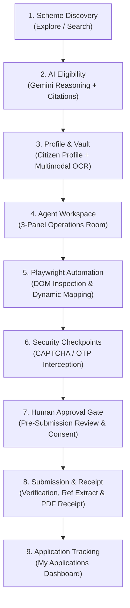

# Phase 12: End-to-End Integration, Demonstration Polish & Production Hardening — Technical Research

## 1. End-to-End Lifecycle Architecture

CivicPilot transforms bureaucratic government application friction into an autonomous, guided experience inspired by MakeMyTrip. The complete end-to-end user lifecycle spans 8 discrete stages across frontend and backend:

### Stage-by-Stage Verification Contracts:
1. **Discovery & Search (`/services`):**
   - Natural language search and category filtering (`Education`, `Healthcare`, `Agriculture`, `Social Welfare`).
   - Official scheme schemas with genuine `.gov.in` portal links and issuing ministry metadata.
2. **AI Eligibility Engine (`/services/[serviceId]`):**
   - Evaluates citizen profile against official guidelines via Gemini 2.5 Flash.
   - Returns structured `is_eligible`, numerical confidence (`0.0 - 1.0`), verbatim citations of official guidelines, and statutory advisory disclaimers.
3. **Citizen Profile & Document Vault (`/profile`, `/documents`):**
   - AES-encrypted document storage with MIME validation.
   - Multimodal OCR extracting structured identity attributes from Aadhaar, Income, and Caste certificates.
4. **Agent Operations Room (`/applications/workspace/[sessionId]`):**
   - 3-Panel MakeMyTrip layout: Profile Context (left), Live Chromium Stream & Controls (center), AI Reasoning & Audit Log (right).
   - Real-time bi-directional streaming via WebSocket (`/ws/agent/{sessionId}`).
5. **DOM Inspection & Dynamic Field Mapping:**
   - Playwright Chromium navigates to portal endpoint.
   - `DOMInspector` prunes noise and generates clean semantic accessibility tree.
   - `DynamicFieldMapper` matches citizen profile attributes and vault certificates to form locators.
6. **Security Challenge Interception (`HIL-04`):**
   - `SecurityChallengeDetector` detects CAPTCHA image, reCAPTCHA, Cloudflare Turnstile, and OTP prompts.
   - Automation suspends cleanly; displays guidance banner; unblocks upon 1-click citizen resolution.
7. **Human-in-the-Loop Approval Gate (`HIL-01`, `HIL-02`, `HIL-03`):**
   - LangGraph pauses at `waiting_approval`.
   - Compiles `PreSubmissionSummary` with table of entered attributes and attached vault certificates.
   - Citizen provides explicit consent; unapproved applications never transmit data.
8. **Submission Verification & Receipt Retrieval (`APP-01`, `APP-02`, `APP-05`):**
   - `SubmissionVerifier` detects authentic confirmation text and parses reference numbers (`NSP2026/APPL/894125`, `PMK-MH-948123`, `AB-PMJAY-2026-441290`).
   - `ReceiptGenerator` outputs an authentic Government of India vector PDF acknowledgement slip with Ashoka Lion emblem and SHA-256 digital verification seal.
9. **"My Applications" Dashboard (`/applications`) (`APP-03`, `APP-04`):**
   - Summary metrics, status filters, copyable reference numbers, timestamps, target portal links, and direct receipt download.

---

## 2. Hardening Error Scenarios & Edge Cases

| Scenario | System Behavior | Guarantees |
|---|---|---|
| **Ineligible Citizen Profile** | Rejection with clear official reason and guideline citation | Never attempts futile application on portal |
| **Missing Mandatory Profile Fields** | High-contrast warning alert detailing exact missing fields | Prompts citizen to update vault/profile |
| **Portal Security Challenge (CAPTCHA/OTP)** | Pauses automation; presents interactive checkpoint banner | Playwright session persists; resumes on solve |
| **Citizen Rejection at Review Gate** | Transitions to `submission_rejected`; halts browser | Zero data transmitted to portal; uncommitted inputs discarded |
| **Portal DOM Changes / Locators Missing** | Bounded cyclical recovery (up to 3 retries) | Never enters infinite loop; escalates to human assistance |
| **Browser Crash / Network Disconnect** | `browser_manager` handles cleanup; WebSocket notifies UI | No zombie Chromium processes left running |

---

## 3. Production Environment & Documentation Strategy

### Configuration Files Needed:
1. `.env.example`:
   - Unified template documenting all required variables for backend (`PORT`, `CORS_ORIGINS`, `GEMINI_API_KEY`, `SUPABASE_URL`, `SUPABASE_ANON_KEY`, `PLAYWRIGHT_HEADLESS`) and frontend (`NEXT_PUBLIC_API_URL`, `NEXT_PUBLIC_SUPABASE_URL`, `NEXT_PUBLIC_SUPABASE_ANON_KEY`).
2. `README.md`:
   - Consumer travel platform philosophy (MakeMyTrip design system).
   - Core value proposition and zero dummy data commitment.
   - Comprehensive system architecture diagrams (Mermaid).
   - Step-by-step developer setup & execution guide (PowerShell / Linux).
   - Test execution instructions (71+ pytests, Next.js build).
   - 5-Minute Guided Demonstration Walkthrough for Hackathon Judges.
   - Statutory compliance and legal disclosures under the Information Technology Act, 2000.
