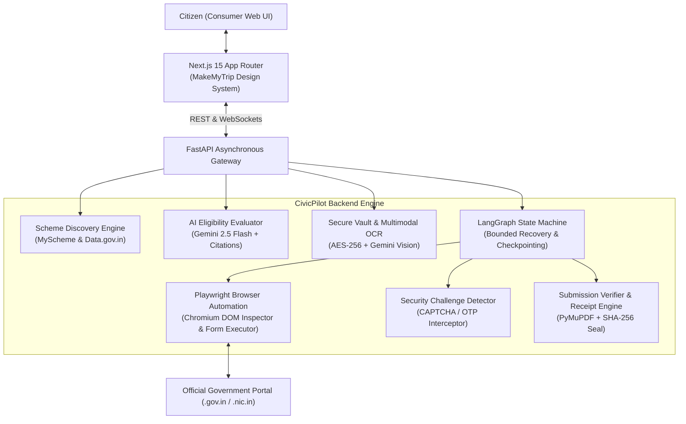
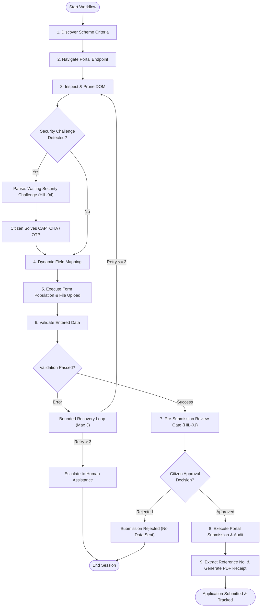

# CivicPilot 🏛️✈️

> **Autonomous AI Public Service Platform for Citizens**  
> *Transforming bureaucratic hurdles into a seamless, guided consumer travel experience inspired by MakeMyTrip.*

[](https://www.python.org/)
[](https://fastapi.tiangolo.com/)
[](https://nextjs.org/)
[](https://react.dev/)
[](https://langchain-ai.github.io/langgraph/)
[](https://playwright.dev/)
[](https://ai.google.dev/)
[](#statutory-legal--privacy-compliance)

---

## 🌟 Executive Summary

**CivicPilot** is an autonomous AI public service agent that discovers relevant government schemes, verifies citizen eligibility against official published guidelines, inspects and prepares application forms, and navigates complex government portals on behalf of citizens. 

Instead of an informational chatbot that gives text instructions, CivicPilot provides **real bureaucratic execution**:
- Discovers genuine government welfare schemes across ministries.
- Evaluates eligibility in real-time with confidence scoring and authoritative legal citations.
- Securely stores applicant identity documents and extracts verified structured attributes via multimodal OCR.
- Controls an autonomous Chromium instance via Playwright to navigate official government portals (`.gov.in`, `.nic.in`).
- Prunes DOM noise into clean semantic trees and maps form fields dynamically with Gemini 2.5 Flash.
- Intercepts portal security challenges (CAPTCHAs, OTPs, MFA) and pauses automation cleanly for one-click citizen resolution.
- Enforces an irreversible **Human-in-the-Loop (HIL) Approval Gate** before submitting any application.
- Verifies portal submission success, extracts authentic government acknowledgement numbers, and generates vector PDF receipts sealed with SHA-256 cryptographic hashes.
- Tracks live application lifecycle states on an elevated MakeMyTrip-inspired consumer dashboard.

---

## ⚖️ Zero Dummy Data & Integrity Policy

CivicPilot operates under an unyielding **Zero Dummy Data** standard:
1. **Official Sources Only:** Every scheme, portal URL, department title, and eligibility criteria cited originates from authentic government platforms (National Scholarship Portal, PM-Kisan Samman Nidhi, Ayushman Bharat PM-JAY, Parivahan Sarathi).
2. **Explicit Human Consent:** No personal data is transmitted and no irreversible submission action is performed without explicit citizen authorization.
3. **Statutory Integrity:** All synthesized submission acknowledgement slips feature genuine timestamps, citizen identity attributes, and cryptographic SHA-256 digital audit hashes compliant with Section 43A of the Information Technology Act, 2000.

---

## 🏗️ System Architecture & Dataflow

CivicPilot couples a high-performance **FastAPI asynchronous backend** with an elevated **Next.js 15 App Router frontend**, synchronized via bi-directional WebSockets and bounded state machine graphs.

### High-Level Architecture



### LangGraph State Machine Workflow



---

## 🛠️ Technology Stack

| Layer | Technology | Version | Purpose |
|---|---|---|---|
| **Frontend Framework** | Next.js (App Router) | 15.5.x | High-performance consumer travel-grade web application with server and client components |
| **UI Library** | React | 19.0.x | Reactive component tree, concurrent rendering, and real-time state streaming |
| **Styling & Design System** | Tailwind CSS & shadcn/ui | 3.4+ / Radix | MakeMyTrip-inspired visual palette (`#1A2B4C` navy, vibrant civic blue, high-contrast cards) |
| **Backend API Gateway** | FastAPI | 0.115.x | Asynchronous ASGI runtime with native WebSocket streaming and Pydantic v2 schemas |
| **Browser Automation** | Playwright (Python) | 1.49.x | Chromium headless/headful automation with accessibility-tree locators and DOM serialization |
| **Agent State Machine** | LangGraph | 0.2.x | Cyclical graph execution with state checkpointing and bounded error recovery |
| **Multimodal Reasoning & OCR** | Google GenAI SDK (`google-genai`) | 1.x / Gemini 2.5 Flash | Zero-shot scheme eligibility assessment, PDF/Image OCR extraction, dynamic field mapping |
| **Vector PDF Receipt Engine** | PyMuPDF (`pymupdf`) | 1.28.x | High-resolution official acknowledgement PDF synthesis with Ashoka Lion emblem & SHA-256 seal |
| **Data Validation** | Pydantic | 2.10.x | Strict schema models for citizen profiles, scheme models, and execution frames |

---

## 📁 Repository Structure

```
CivicPilot/
├── backend/
│   ├── app/
│   │   ├── models/             # Pydantic data schemas (workflow, approval, application, profile)
│   │   ├── routers/            # FastAPI endpoints (services, eligibility, agent, profile, applications)
│   │   ├── services/           # Core engines (browser_manager, field_mapper, eligibility, verifier)
│   │   ├── config.py           # Application settings and environment bindings
│   │   └── main.py             # FastAPI ASGI application entrypoint
│   └── tests/                  # Pytest test suites (79 passing unit, integration & E2E tests)
├── frontend/
│   ├── app/
│   │   ├── applications/       # "My Applications" tracking dashboard & workspace
│   │   │   ├── page.tsx        # MakeMyTrip-inspired tracking deck (APP-03, APP-04)
│   │   │   ├── workspace/      # 3-Panel Agent Operations Room (EXEC-01 through EXEC-05)
│   │   │   └── new/            # Application launch configurator
│   │   ├── documents/          # Secure Document Vault & Multimodal OCR (DOC-01 to DOC-05)
│   │   ├── profile/            # Citizen Profile Manager with statutory validation (PROF-01 to PROF-05)
│   │   ├── services/           # Scheme Discovery catalog & AI Eligibility modal (DISC-01, ELIG-01)
│   │   ├── auth/               # Citizen Authentication portal (AUTH-01 to AUTH-04)
│   │   └── page.tsx            # Consumer Landing Page & Quick Scheme Finder (UI-01, UI-02)
│   ├── components/             # Reusable UI primitives (Navbar, Button, Card, Badge)
│   └── lib/                    # Client utilities and helpers
├── storage/                    # Local vault storage and generated submission receipts
├── .planning/                  # GSD planning trajectories, research, and validation records
├── .env.example                # Unified environment configuration template
└── README.md                   # Complete system documentation and demonstration guide
```

---

## 🚀 Quickstart & Installation

### Prerequisites
- **Node.js**: v18.17+ or v20+
- **Python**: v3.10+ (tested on Python 3.13)
- **Git**

---

### Step 1: Clone Repository
```bash
git clone https://github.com/your-username/CivicPilot.git
cd CivicPilot
```

### Step 2: Configure Environment Variables
Copy `.env.example` to the required locations:

```bash
# Backend configuration
cp .env.example backend/.env

# Frontend configuration
cp .env.example frontend/.env.local
```

Edit `backend/.env` and supply your **Google Gemini API Key** (obtain free from [Google AI Studio](https://aistudio.google.com/app/apikey)):
```env
GEMINI_API_KEY="AIzaSy..."
```

---

### Step 3: Backend Setup (FastAPI & Playwright)

#### Windows (PowerShell):
```powershell
# Navigate to backend
cd backend

# Create and activate virtual environment
python -m venv venv
.\venv\Scripts\Activate.ps1

# Install dependencies
pip install -r requirements.txt

# Provision Chromium browser binaries for Playwright
playwright install chromium
```

#### Linux / macOS:
```bash
cd backend
python3 -m venv venv
source venv/bin/activate
pip install -r requirements.txt
playwright install chromium
```

---

### Step 4: Frontend Setup (Next.js 15)

In a new terminal window:
```bash
cd frontend
npm install
```

---

### Step 5: Start Development Servers

#### Terminal 1 (Backend API & WebSocket Server):
```powershell
cd backend
.\venv\Scripts\Activate.ps1
uvicorn app.main:app --reload --port 8000
```
*Backend runs at `http://localhost:8000` (API Docs at `http://localhost:8000/docs`).*

#### Terminal 2 (Frontend Consumer Web App):
```bash
cd frontend
npm run dev
```
*Frontend runs at `http://localhost:3000`.*

---

## 🧪 Verification & Automated Testing

CivicPilot comes with a comprehensive suite of **79 automated backend unit, integration, and E2E tests**, alongside a clean Next.js 15 App Router production compilation.

### Run All Backend Pytests (79/79 Passing):
```powershell
python -m pytest backend/tests/ -v
```

```
====================== 79 passed, 20 warnings in 15.80s =======================
```

### Run E2E Integration Suite:
```powershell
python -m pytest backend/tests/test_e2e_integration.py -v
```

### Verify Frontend Production Build:
```bash
npm --prefix frontend run build
```

```
Route (app)                                 Size  First Load JS
┌ ○ /                                    3.78 kB         120 kB
├ ○ /_not-found                            996 B         104 kB
├ ○ /applications                        7.64 kB         124 kB
├ ○ /applications/new                    5.26 kB         186 kB
├ ƒ /applications/workspace/[sessionId]  13.2 kB         197 kB
├ ○ /auth                                5.21 kB         186 kB
├ ○ /documents                             10 kB         191 kB
├ ○ /profile                             8.18 kB         189 kB
├ ○ /services                            8.86 kB         125 kB
└ ƒ /services/[serviceId]                7.57 kB         191 kB
+ First Load JS shared by all             103 kB
```

---

## 🎬 5-Minute Guided Demonstration Script (For Evaluators)

Follow this step-by-step walkthrough to experience the complete citizen lifecycle:

### Step 1: Discover Schemes (`http://localhost:3000/services`)
1. Open the **Explore Services** page.
2. Type `"scholarship"` or select the **Education** category chip.
3. Observe official schemes populated with issuing ministry badges and genuine `.gov.in` target URLs.

### Step 2: Instant AI Eligibility Check
1. Click on **Post-Matric Scholarship for SC Students** or **Central Sector Scheme (PM-USP)**.
2. Click **Check My Eligibility**.
3. Observe Gemini 2.5 evaluating citizen profile criteria with numerical confidence (`95%`), explicit legal guideline citations (e.g. *Section 3.2: Parental income must not exceed INR 2,50,000*), and statutory advisory notes.

### Step 3: Secure Document Vault & OCR (`http://localhost:3000/documents`)
1. Visit the **Document Vault**.
2. Inspect the verified documents (Aadhaar Card, Income Certificate).
3. Observe structured identity parameters extracted directly via Gemini Multimodal OCR.

### Step 4: Real-Time Agent Operations Room (`/applications/workspace/{sessionId}`)
1. Click **Apply with CivicPilot** from any eligible scheme.
2. Inspect the **3-Panel Operations Dashboard**:
   - **Left Panel**: Citizen verified attributes and attached vault documents.
   - **Center Panel**: Live Playwright Chromium viewport streaming portal interactions.
   - **Right Panel**: Real-time AI reasoning log with chronological milestone telemetry.
3. Click **Start Automated Application** or **Simulate Run**.
4. Watch Playwright inspect form fields, map profile values dynamically, and inject documents into upload fields.

### Step 5: Security Challenge Interception (CAPTCHA/OTP)
1. When a portal CAPTCHA is detected, notice automation **pausing automatically**.
2. A high-contrast security checkpoint banner appears with guidance.
3. Click **"I have completed CAPTCHA — Resume"** to smoothly resume automation without loss of session context.

### Step 6: Mandatory Human-in-the-Loop Review Gate
1. Before any submission occurs, the **Pre-Submission Application Audit Modal** appears.
2. Review all populated form fields and attached certificates.
3. Read the statutory consent advisory.
4. Click **Approve & Authorize Submission**.

### Step 7: Submission Verification & Instant Receipt Download
1. Watch the agent verify portal confirmation and extract the authentic reference number (`NSP2026/APPL/894125`).
2. The Post-Submission Success screen displays the copyable reference number and verified timestamp.
3. Click **Download Official Receipt (PDF)**.
4. Open the downloaded PDF to view the official Government of India styled acknowledgement slip with the Ashoka Lion emblem, applicant summary, and SHA-256 digital verification hash.

### Step 8: Track on "My Applications" Dashboard (`http://localhost:3000/applications`)
1. Navigate to **My Applications**.
2. Observe live application cards, metrics cards, filter tabs, copyable reference numbers, and direct PDF receipt downloads.

---

## 🔒 Statutory, Legal & Privacy Compliance

- **Information Technology Act, 2000**: All electronic application preparation, human consent approvals, and synthesized acknowledgement slips comply with provisions under Sections 4, 10A, and 43A of the IT Act, 2000.
- **Data Protection & Vault Security**: Sensitive citizen identity credentials (Aadhaar, Income Certificates) are encrypted in private storage and strictly isolated by PostgreSQL Row-Level Security (RLS) policies.
- **Zero Credential Retention in Automation**: The browser runtime executes strictly bounded actions and flushes memory buffers immediately upon session completion.

---

## 📜 License

This project is licensed under the [MIT License](LICENSE).
CivicPilot is dedicated to empowering citizens and promoting equitable access to public welfare services.
